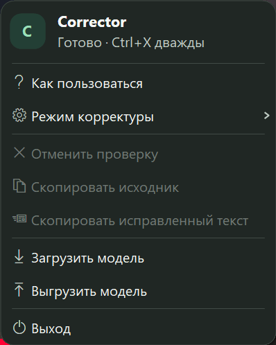

#  Corrector

Локальный корректор русского и английского текста для Windows x64. Дважды нажми Ctrl+X, чтобы исправить абзац или выделенный фрагмент. Есть отдельный режим для стихов.

## Установка

Для новой установки или ручного обновления скачай [установщик Corrector 1.4.3 для Windows x64](https://github.com/mrrepac/Corrector/releases/download/v1.4.3/Corrector-Setup-1.4.3-win-x64.exe). Если АБВ уже запущена, закрой её через меню в трее и запусти установщик. Установщик 1.4.3 распространяется без подписи Authenticode. По умолчанию программа установится в `%LOCALAPPDATA%\Programs\Corrector` для текущего пользователя. Ярлык появится в меню «Пуск». В мастере можно выбрать другую папку и добавить ярлык на рабочий стол.

**Если уже пользуешься ZIP-версией**, закрой Corrector через меню в трее и в мастере выбери папку, где лежат `Corrector.exe` и `assets`. Тогда программа использует уже скачанную модель. При последующих обновлениях установщик сам подставит прежнюю папку.

Для переносимой установки доступен [ZIP-архив](https://github.com/mrrepac/Corrector/releases/download/v1.4.3/Corrector-1.4.3-win-x64.zip). Распакуй его целиком в папку с правом записи и запусти `Corrector.exe`.

При первой корректуре или переводе Corrector скачивает модель Gemma (6,72 ГБ) и архивы движка (около 0,76 ГБ). Оставь не менее 10 ГБ свободного места и дождись уведомления о готовности. После успешного запуска движка Corrector удаляет его установочные архивы. Дальше проверка работает локально.

При запуске и каждые четыре часа Corrector проверяет стабильные релизы на GitHub. Новую версию он скачивает в фоне. Перед запуском проверяет размер, SHA-256, версию и доверенную подпись Authenticode. Установщик должен быть подписан тем же сертификатом, что и запущенный Corrector. Для локальной неподписанной сборки или смены сертификата требуется ручная установка. Когда обработка текста и загрузка модели завершены, а настройки и карточка перевода закрыты, Corrector устанавливает обновление в свою папку и сам перезапускается. Модель и настройки сохраняются. Проверить обновления сразу можно через **C → Проверить обновления**. Для перехода с версии 1.3.0 или более ранней один раз запусти новый установщик вручную.

Удалить установленную программу можно в параметрах Windows через «Приложения». Скачанная модель и настройки сохраняются.

## Как пользоваться

1. Допиши абзац или четверостишие и оставь курсор в конце. Пустая строка отделяет его от предыдущего текста. Строка из пробелов или табуляций тоже считается пустой.
2. Быстро нажми **Ctrl+X дважды** (интервал до 0,7 секунды). Можно держать Ctrl и дважды нажать X.
3. Corrector выделит текст от ближайшей пустой строки сверху до курсора. Если разделителя нет, проверка начинается от начала поля. Чтобы задать другие границы, выдели нужный фрагмент перед командой.
4. Дождись окончания проверки, сохраняя курсор на месте. Выделенный фрагмент заменяется на месте. Без выделения Corrector исправляет текст до курсора. **Enter** нажимается один раз только после подтверждённой вставки, если до проверки курсор стоял в конце строки. В редакторе это новая строка. В чате с отправкой по Enter отправляется всё содержимое поля по обычным правилам приложения.
5. При изменении чисел, ссылок или существенной переработке текста Corrector показывает результат в карточке. Автоматическая вставка и Enter доступны только для прошедших проверку результатов. Если границы текста в Obsidian или MAX неоднозначны, выдели нужный фрагмент вручную.
6. Исходный абзац остаётся в буфере, а обе версии доступны через меню значка **C**.

Одиночное Ctrl+X остаётся обычным вырезанием, без задержки. Удержание X не считается двойным нажатием. Между двумя нажатиями не кликай мышью и не набирай другие символы.

## Калькулятор

Напиши выражение со знаком `=` на конце, оставь курсор сразу после него и дважды нажми **Ctrl+X**. Например, `Итого: 15+145=` превратится в `Итого: 15+145=160`. Курсор останется после ответа. Можно продолжить ту же строку. Калькулятор работает локально, в том числе при выгруженной модели.

Поддерживаются `+`, `-`, `*`, `/`, скобки, отрицательные числа и десятичные дроби с запятой или точкой. Умножение и деление выполняются раньше сложения и вычитания.

| Пример | Ответ |
| --- | --- |
| `200+15%=` | 230 |
| `200-15%=` | 170 |
| `200*15%=` | 30 |
| `200/25%=` | 800 |
| `15%=` | 0,15 |
| `(7,5+2,5)/4=` | 2,5 |

При сложении и вычитании процент справа считается от текущей суммы. Например, `100+10%-10%=99`, поскольку вторые 10% берутся от 110.

## Перевод выделенного текста

Чтобы перевести с английского на русский, выдели слово, предложение или несколько абзацев на странице браузера или в текстовом поле и дважды нажми **Ctrl+X**. Рядом с указателем откроется окно с переводом на русский. Перевод делает та же локальная модель. Можно продолжать читать страницу, а готовый перевод при желании забрать кнопкой **Скопировать**. Крестик закрывает окно и отменяет перевод, если он ещё идёт.

Перевод открывается в карточке в стиле уведомлений Corrector и остаётся на экране до закрытия. Заголовок позволяет переместить карточку, нижний правый угол — изменить размер. Карточка следует теме приложений Windows. Её размер зависит от длины перевода. Если текст не помещается целиком в рабочей области монитора, появляется вертикальная прокрутка.

Перевод включается только для ручного выделения. Corrector различает русский и английский по алфавиту. Смешанный текст остаётся в режиме корректуры. Без выделения двойной Ctrl+X проверяет черновик до курсора.

## Настройки

Открой меню значка **C → Настройки…**. Здесь можно включить запуск при входе в Windows и выбрать направление работы: корректура русского с переводом английских выделений на русский или корректура английского с переводом русских выделений на английский.

По умолчанию модель загружается для первого запроса и выгружается через 10 минут простоя. Чтобы ускорить первый запрос, включи **Загружать модель при запуске и держать в памяти**. Калькулятору модель не требуется.

В разделе **Промпты модели** выбери **Проза**, **Стихи** или **Перевод** и отредактируй инструкцию. Для каждого направления хранится свой набор. Кнопка **Восстановить этот промпт** возвращает исходную инструкцию только для выбранной задачи. Нажми **Сохранить**, чтобы применить изменения со следующего двойного Ctrl+X.

## Значок в трее

Открой `Corrector.exe` — появится только значок **C** в системном трее. По умолчанию модель загрузится при первой корректуре или переводе. Основное окно не открывается ни при запуске, ни по завершении, ни при ошибке. Повторный запуск не показывает диалог.

Начало и результат проверки появляются в небольшой карточке внизу по центру активного экрана. Карточка сама исчезает, фокус остаётся в редакторе. Наведи мышь на значок C или открой его меню — там видны статус и время проверки. В меню доступны:

- отмена текущей проверки;
- копирование последнего исходника;
- копирование последнего исправленного текста;
- загрузка и выгрузка модели;
- выход из программы.

Если во время проверки изменились активное поле, ввод или буфер обмена, автоматическая вставка отменяется. Результат остаётся доступен через **C → Скопировать исправленный текст**. Исходник можно забрать через **C → Скопировать исходник**. Программа не возвращает фокус принудительно и не открывает окно.

Если первое Ctrl+X вырезало выделение или текущую строку, Corrector использует Ctrl+Z для восстановления перед проверкой. В заметках Obsidian Corrector определяет границы выделения командами редактора и сверяет текст через буфер обмена. Плагин для хранилища не требуется. В MAX, если поле сообщения недоступно через Windows UI Automation, Corrector выделяет абзац клавиатурой и сверяет его через буфер обмена. Перед Enter он проверяет, что вставка сняла выделение и исправленный текст находится перед курсором. В остальных приложениях для определения курсора используется Windows UI Automation. Если редактор не подтвердил вставку, Corrector пропустит Enter. Обе версии текста хранятся в памяти до следующей проверки или завершения программы.

В меню **C → Режим корректуры** по умолчанию включено **Авто**. Две соседние строки длиной до 100 символов с буквами без маркеров списка считаются признаком стихов. Для одной стихотворной строки можно выбрать **Стихи**, для разбитой на короткие строки прозы — **Проза**. Выбор действует до смены режима или выхода. Для стихов используется отдельная инструкция и температура 0: корректору дано указание сохранять авторские переносы, инверсию, разговорную речь и составные рифмы. В прямом вопросе он может восстановить пропущенный вопросительный знак, в том числе при переносе вопроса на следующую строку. Конец строки сам по себе не требует точки. Для русской прозы при температуре 0,2 инструкция учитывает короткие сообщения без конечной точки, сленг и контекст названий программ.

## Модель и ограничения

Используется Gemma 4 12B IT QAT (UD-Q4_K_XL, 6,72 ГБ). Движок llama.cpp запускается в фоне и закрывается вместе с программой. При загрузке модели Corrector сначала использует видеокарту. Если запуск с GPU не удался, Corrector пробует запустить модель на CPU.

При двойном Ctrl+X длинный текст проверяется частями до **6000 символов**. Corrector предпочитает границы абзацев, строк и предложений и сохраняет разделители между частями. В трее виден номер текущей части, там же можно отменить проверку. Вставка выполняется один раз после завершения. Если отдельное слово или ссылка длиннее 6000 символов, Corrector предлагает выбрать меньший фрагмент. В отдельном редакторе (`--editor`) действует лимит 6000 символов на запрос.

Используется обычный текст: шрифты, цвета и другое богатое форматирование при вставке результата не сохраняются. Исходник в буфере сохраняется обычным текстом. Нужны редактируемые поля с поддержкой Ctrl+X/Ctrl+V. Приложения с правами администратора и нестандартным вводом могут не поддерживаться.

Корректура и перевод выполняются локально. Системный буфер подчиняется настройкам истории и синхронизации Windows. Внутренний движок слушает только 127.0.0.1 с автоматически созданным ключом; пользователь ничего не настраивает. Рабочие тексты не пишутся в журналы. Если папка модели отсутствует, приложение само скачивает закреплённые файлы и проверяет SHA-256.

## Разработка

C# / WinForms и WPF, .NET 10 LTS. Для сборки нужен актуальный .NET 10 SDK. `build.ps1` собирает самостоятельную Windows x64 версию; отдельно устанавливать .NET не нужно. Переноси папку `release` целиком, вместе с `assets`. `assets.lock.json` содержит версии, URL, размеры и SHA-256.

Для сборки установщика нужен NSIS 3. Запусти `./build-installer.ps1`: скрипт соберёт программу и положит готовый EXE в `dist`. Чтобы упаковать точную копию уже выпущенной версии, передай её ZIP через `-PortableZip`. Путь к `makensis.exe` можно указать через `-Compiler`. Для подписанного выпуска передай в оба сборочных скрипта `-SigningThumbprint` с отпечатком сертификата подписи кода из хранилища текущего пользователя. Автопереход с неподписанных выпусков на доверенную цепочку требует однократной ручной установки из проверенного источника.

Старый редактор доступен только при явном запуске с `--editor`; в обычной работе он не используется. `--clipboard-test` проверяет восстановление буфера и вставку исходника на скрытом тестовом поле без ввода в пользовательские окна; `--self-test` запускает программные проверки; `--model-test` — примеры на настоящей модели; `--input-fixture` — отдельное тестовое окно с кнопками для воспроизведения клавиатурных сценариев.

Диагностика запуска: `%LOCALAPPDATA%/Corrector/engine-startup.log`. Лицензии: [THIRD_PARTY.md](THIRD_PARTY.md).
