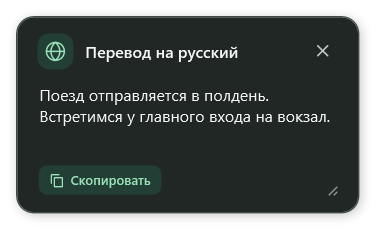

# Corrector

Локальный корректор русского текста для Windows x64. Дважды нажми Ctrl+X, чтобы исправить абзац или выделенный фрагмент. Есть отдельный режим для стихов.

## Установка

1. Скачай **Corrector-1.1.0-win-x64.zip** со [страницы релизов](https://github.com/mrrepac/Corrector/releases/latest).
2. Распакуй архив целиком в папку, куда у тебя есть право записи.
3. Запусти **Corrector.exe**. При первом запуске программа скачает модель Gemma (6,72 ГБ) и архивы движка (около 0,76 ГБ). Оставь не менее 10 ГБ свободного места. Дождись уведомления о готовности.
4. В дальнейшем проверка работает локально. Если для загрузки модели используется CPU, время обработки зависит от процессора и доступной оперативной памяти.

## Как пользоваться

1. Допиши абзац или четверостишие и оставь курсор в конце. Пустая строка отделяет его от предыдущего текста. Строка из пробелов или табуляций тоже считается пустой.
2. Быстро нажми **Ctrl+X дважды** (интервал до 0,7 секунды). Можно держать Ctrl и дважды нажать X.
3. Corrector выделит текст от ближайшей пустой строки сверху до курсора. Если разделителя нет, проверка начинается от начала поля. Чтобы задать другие границы, выдели нужный фрагмент перед командой.
4. Дождись окончания проверки, сохраняя курсор на месте. Выделенный фрагмент заменяется на месте. Без выделения Corrector исправляет текст до курсора. **Enter** нажимается один раз только после подтверждённой вставки, если до проверки курсор стоял в конце строки. В редакторе это новая строка. В чате с отправкой по Enter отправляется всё содержимое поля по обычным правилам приложения.
5. Исходный абзац остаётся в буфере, а обе версии доступны через меню значка **C**.

Одиночное Ctrl+X остаётся обычным вырезанием, без задержки. Удержание X не считается двойным нажатием. Между двумя нажатиями не кликай мышью и не набирай другие символы.

## Перевод выделенного текста

Выдели английское слово, предложение или несколько абзацев на странице браузера или в текстовом поле и дважды нажми **Ctrl+X**. Рядом с указателем откроется окно с переводом на русский. Перевод делает та же локальная модель. Можно продолжать читать страницу, а готовый перевод при желании забрать кнопкой **Скопировать**. Крестик закрывает окно и отменяет перевод, если он ещё идёт.

Перевод открывается в карточке в стиле уведомлений Corrector и остаётся на экране до закрытия. Заголовок позволяет переместить карточку, нижний правый угол — изменить размер. Карточка следует теме приложений Windows. Её размер зависит от длины перевода. Если текст не помещается целиком в рабочей области монитора, появляется вертикальная прокрутка.

Перевод включается при ручном выделении с буквами A–Z или a–z без кириллицы. Под это правило попадают и другие языки на латинице. В режиме перевода исходный текст остаётся на месте, Enter не нажимается. Если в выделении есть кириллица или в редакторе просто стоит курсор, действует обычная корректура.

## Значок в трее

Открой `Corrector.exe` — появится только значок **C** в системном трее. Модель загрузится сама. Основное окно не открывается ни при запуске, ни по завершении, ни при ошибке. Повторный запуск не показывает диалог.

Начало и результат проверки появляются в небольшой карточке внизу по центру активного экрана. Карточка сама исчезает, фокус остаётся в редакторе. Наведи мышь на значок C или открой его меню — там видны статус и время проверки. В меню доступны:

- отмена текущей проверки;
- копирование последнего исходника;
- копирование последнего исправленного текста;
- загрузка и выгрузка модели;
- выход из программы.

Если во время проверки изменились активное поле, ввод или буфер обмена, автоматическая вставка отменяется. Результат остаётся доступен через **C → Скопировать исправленный текст**. Исходник можно забрать через **C → Скопировать исходник**. Программа не возвращает фокус принудительно и не открывает окно.

Если первое Ctrl+X вырезало выделение или текущую строку, Corrector использует Ctrl+Z для восстановления перед проверкой. В заметках Obsidian Corrector определяет границы выделения командами редактора и сверяет текст через буфер обмена. Плагин для хранилища не требуется. В MAX, если поле сообщения недоступно через Windows UI Automation, Corrector выделяет абзац клавиатурой и сверяет его через буфер обмена. Перед Enter он проверяет, что вставка сняла выделение и исправленный текст находится перед курсором. В остальных приложениях для определения курсора используется Windows UI Automation. Если редактор не подтвердил вставку, Corrector пропустит Enter. Обе версии текста хранятся в памяти до следующей проверки или завершения программы.

В меню **C → Режим корректуры** по умолчанию включено **Авто**. Две соседние строки длиной до 100 символов с буквами без маркеров списка считаются признаком стихов. Для одной стихотворной строки можно выбрать **Стихи**, для разбитой на короткие строки прозы — **Проза**. Выбор действует до смены режима или выхода. Для стихов используется отдельная инструкция и температура 0, для прозы — обычная корректура и температура 0,2.

## Модель и ограничения

Используется Gemma 4 12B IT QAT (UD-Q4_K_XL, 6,72 ГБ). Движок llama.cpp запускается в фоне и закрывается вместе с программой. При запуске Corrector загружает модель на видеокарту. Если запуск с GPU не удался, Corrector пробует запустить модель на CPU.

При двойном Ctrl+X длинный текст проверяется частями до **6000 символов**. Corrector предпочитает границы абзацев, строк и предложений и сохраняет разделители между частями. В трее виден номер текущей части, там же можно отменить проверку. Вставка выполняется один раз после завершения. Если отдельное слово или ссылка длиннее 6000 символов, Corrector предлагает выбрать меньший фрагмент. В отдельном редакторе (`--editor`) действует лимит 6000 символов на запрос.

Используется обычный текст: шрифты, цвета и другое богатое форматирование при вставке результата не сохраняются. Исходник в буфере сохраняется обычным текстом. Нужны редактируемые поля с поддержкой Ctrl+X/Ctrl+V. Приложения с правами администратора и нестандартным вводом могут не поддерживаться.

Текст не отправляется в интернет. Внутренний движок слушает только 127.0.0.1 с автоматически созданным ключом; пользователь ничего не настраивает. Рабочие тексты не пишутся в журналы. Если папка модели отсутствует, приложение само скачивает закреплённые файлы и проверяет SHA-256.

## Разработка

C# / WinForms, .NET 9. `build.ps1` собирает самостоятельную Windows x64 версию; отдельно устанавливать .NET не нужно. Переноси папку `release` целиком, вместе с `assets`. `assets.lock.json` содержит версии, URL, размеры и SHA-256.

Старый редактор доступен только при явном запуске с `--editor`; в обычной работе он не используется. `--clipboard-test` проверяет восстановление буфера и вставку исходника на скрытом тестовом поле без ввода в пользовательские окна; `--self-test` запускает программные проверки; `--model-test` — примеры на настоящей модели; `--input-fixture` — отдельное тестовое окно с кнопками для воспроизведения клавиатурных сценариев.

Диагностика запуска: `%LOCALAPPDATA%/Corrector/engine-startup.log`. Лицензии: [THIRD_PARTY.md](THIRD_PARTY.md).
